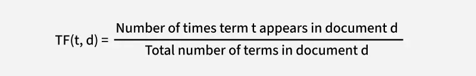
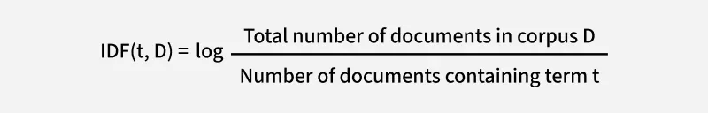
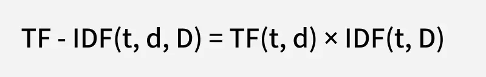
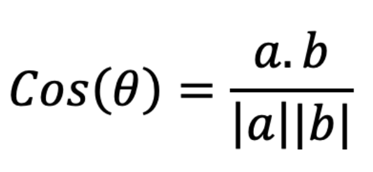

# Introduction
Imagine remebering that your cat hid during the noise of the new years fireworks, but you forget how exactly you described in your diary.

You might search "scared of fireworks", but the orignal dairy said "Milo hid under the bed when the loud bangs started outside". Keyword based searching will miss that.

In my app TailsTales, a pet diary applicaiton, I want the users to retrieve past experiences using the words they remember.

# What is Information Retrieval?

Information Retrieval (IR) is the process of finding relevant information from a collection of documents in response to a user's query. 


# From Keyword Matching to Ranked Retrieval
A basic search system can retrieve documents using Boolean condition:
`fireworkds AND scared`

However, strict matching can return too few results when the diary uses different wording. Broadening the query can produce too many results without indicating which ones are most useful.

**Ranked retrieval** addresses this by assigning each document a score and returning the highest-scoring results first.

For TailTales, this fits the interaction I wanted: users describe a memory in natural language and receive a short list of potentially relevant entries.

### TF-IDF: A Lexical Baseline
One approach to ranked retrieval is Term Frequency–Inverse Document Frequency, or TF-IDF.
TF-IDF weights words using two signals:

- **Term frequency:** how often a word appears in a document.



- **Inverse document frequency:** how uncommon a word is across the collection.



For example, in TailTales, the word "pet" might appear in almost every diary entry, making it less useful for distinguishing relevant records. In contrast, a term such as "vomiting" might appear in only a small number of entries, making it more informative when searching for a pet's health history.


- The TF-IDF score is the product of TF and IDF:



In short, TF-IDF balances local term frequency with global term rarity, helping identify words that distinguish one document from others.

However, TF-IDF still relies on lexical matching. It cannot inherently recognize that "vomiting" and "throwing up" express similar meanings, which motivates the use of semantic retrieval methods.

## What Is BM25 (Best Matching 25)?
Another popular term is BM25, like TF-IDF, BM25 is a **lexical retrieval method**,it ranks documents based on matching terms rather than understanding their semantic meaning.

However, BM25 *improves* upon basic TF-IDF by addressing two important issues:
1. Term Frequency Saturation: Repeating a keyword many times should not increase relevance indefinitely. For example:
   Doc A: 
   >Luna vomited.
   Doc B:
   >Luna vomited. She vomited again. Vomited several times. Vomited after eating. >Vomited before sleeping.

   Doc B is not neccessarily more important that Doc A.

2. Document Length Normalization: Longer documents naturally contain more words, so they should not automatically receive higher scores.
For example, searching for "vomiting" across two diary entries.
    Doc A: 
    > 20 words, with "vomiting" appearing twice.

    Doc B: 
    >500 words, with "vomiting" appearing twice.

Without length normalization, both documents might receive similar scores from their term frequencies.

However, the keyword is much more concentrated in Document A.

# Why Semantic Search?
Keyword search is useful when users remember specific words. However, memories are often expressed differently from the original writing.

Semantic search uses vector representations of text to capture some of these relationships. Instead of requiring the same words, it ranks entries by how similar their representations are to the query.

That does not mean keyword search becomes unnecessary. Names, unusual terms, and exact phrases can still be strong lexical signals. In fact, my evaluation later showed a query where TF-IDF found the relevant entry and semantic search missed it.
The practical question was therefore: **does semantic retrieval improve the results for the kinds of memories TailTales users might search for**?


# Vector Embeddings
An embedding converts text into a numerical vector:

`Diary content → Embedding model → [0.12, -0.08, ..., 0.04]`

TailTales uses `Xenova/all-MiniLM-L6-v2` through Transformers.js. The implementation produces normalized, 384-dimensional vectors:
```js
const result = await model(truncateText(text), {
  pooling: "mean",
  normalize: true,
});

return Array.from(result.data);
```
TailTales embeds the diary’s content, rather than its title or mood. The same embedding function processes search queries so that both are represented in the same vector space.

The current function also truncates input to the first 1,000 JavaScript string code units before embedding. This keeps the input bounded, but creates a limitation: details near the end of a long entry may not influence retrieval.

When an entry is updated, the backend regenerates its embedding from the submitted content. Otherwise, the stored vector could describe an older version of the diary.

# Measuring Similarity with Cosine Similarity
Once the query and diary entries have embeddings, the next step is to compare them.

Here, \(q\) represents the query and \(d\) represents a diary entry.
The score ranges from −1 to 1. A higher score means the vectors point in a more similar direction.

Because TailTales normalizes its embeddings, their dot product is also equivalent to cosine similarity, apart from numerical precision.
However, similarity is not a probability of relevance. A score of 0.8 does not mean an entry has an 80% chance of answering the query.


# How to measure the accuracy of IR
I used a small offline dataset containing:
- 51 synthetic English diary entries.
- 46 labeled search queries.
- 40 queries with at least one relevant entry.
- Six queries with no relevant entries.


### Recall@K: Did We Find the Relevant Entries?

Recall measures the fraction of relevant entries retrieved in the top K results:

**Recall@K = Relevant entries in the top K / Total relevant entries**

If a query has two relevant entries and both appear in the top six, Recall@6 is 1. If only one appears, it is 0.5.

For TailTales, recall reflects whether a user can find the memory within the returned list.

### Precision@K: How Many Results Are Relevant?


Precision measures the proportion of the top K results that are relevant:

**Precision@K = Relevant entries in the top K / K**

If only one entry is relevant and the system returns six, Precision@6 is at most 1/6, or approximately 0.167.

This is common in the TailTales dataset, where most queries target one specific memory. Precision therefore needs to be interpreted alongside the number of relevant entries and the fixed result count.

### MRR@K: How High Is the First Relevant Result?

Mean Reciprocal Rank measures how highly the first relevant result is ranked, averaged across queries.

For each query:

- If a relevant entry appears within the top K, its reciprocal rank is **1 / rank of the first relevant entry**.
- If no relevant entry appears within the top K, its reciprocal rank is **0**.

The overall score is:

**MRR@K = Sum of reciprocal ranks / Number of evaluated queries**

A relevant entry at rank one contributes 1; at rank two, 0.5; and at rank six, approximately 0.167.


This captures an important part of the experience: finding a memory immediately is better than finding it after scanning the entire list.

In the TailTales evaluation, these metrics are averaged over the 40 answerable queries. The six queries with no relevant entries are excluded and require a separate evaluation of no-match behavior.

---


